# Class diagram

The Phase 2 class design, as built. Contracts are in `matcher/contracts/`,
domain classes in `matcher/domain/`, the managers in `matcher/managers/`,
the service in `matcher/services/` and the views in `matcher/views.py`.
`FakeProvider` and `InMemoryRepository` are test doubles in
`matcher/tests/fakes.py`. Update this diagram if a design changes.

`-` is private (`self._name`), `+` is public, `*` marks abstract methods and
`$` static ones (class methods).

```mermaid
classDiagram
    %% ---------- AI Manager (P2: Simon, Nabil) ----------
    class AIProvider {
        <<interface>>
        +generate(contents) str*
    }
    class AIProviderError
    class GeminiProvider {
        -_api_key
        -_models
        +generate(contents) str
    }
    class FakeProvider {
        -_replies
        +generate(contents) str
    }
    class AITask {
        <<abstract>>
        +name str*
        +build_contents() list*
        +schema_problem(data) str*
    }
    class ResumeExtractionTask
    class JobSuggestionTask
    class CandidateComparisonTask
    class AIManager {
        -_provider : AIProvider
        +run(task : AITask) dict
    }
    AIProvider <|.. GeminiProvider
    AIProvider <|.. FakeProvider
    AIProvider ..> AIProviderError : raises
    AITask <|-- ResumeExtractionTask
    AITask <|-- JobSuggestionTask
    AITask <|-- CandidateComparisonTask
    AIManager o-- AIProvider : aggregation
    AIManager ..> AITask : runs any

    %% ---------- Data Manager (P2: Zara) ----------
    class RecordRepository {
        <<abstract>>
        +load(collection) list*
        +save(collection, record) dict*
        +collection_names() list*
        +find(collection, record_id) dict
        +filter(collection, fields) list
        +newest(collection, fields) dict
        +load_everything() dict
    }
    class JsonRepository {
        -_data_dir
    }
    class InMemoryRepository {
        -_collections
    }
    RecordRepository <|-- JsonRepository
    RecordRepository <|-- InMemoryRepository

    %% ---------- Logic Manager (P2: Tristen) ----------
    class ScoreComponent {
        <<abstract>>
        -_weight
        +weight
        +name str*
        +fraction(candidate) float*
        +points(candidate) float
    }
    class SkillsComponent
    class MatchFlagComponent
    class CandidateScorer {
        +COMPONENT_TYPES$
        -_profile : ScoringProfile
        -_components : list~ScoreComponent~
        -_strong_match_rule : StrongMatchRule
        +score(candidate) MatchResult
        +with_profile(profile) CandidateScorer
    }
    class StrongMatchRule {
        -_min_skills_ratio
        +is_met(candidate) bool
    }
    class CandidateRanker {
        +rank(results) list
    }
    class JobRanker {
        +rank(jobs) list
        +select_top(jobs, max_jobs) list
    }
    class JobFilter {
        +matches(job) bool
        +apply(jobs) list
    }
    ScoreComponent <|-- SkillsComponent
    ScoreComponent <|-- MatchFlagComponent
    CandidateScorer *-- ScoreComponent : composition
    CandidateScorer *-- StrongMatchRule : composition
    CandidateScorer --> ScoringProfile : weighted by
    CandidateRanker ..> MatchResult : orders
    JobRanker ..> JobSuggestion : orders
    JobFilter ..> JobSuggestion : filters

    %% ---------- IO Manager (P2: Li Wei) ----------
    class UploadValidator {
        -_max_size_mb
        -_max_candidates
        +check_pdf(file) str
        +check_resume_upload(files) tuple
        +check_employer_upload(files) tuple
    }
    class JobFilterForm {
        -_filters
        +from_query(query) JobFilterForm$
        +options_for_ai() dict$
        +allowed_value(value, choices) str$
        +filter_bar() dict
    }
    class ScoringProfileForm {
        -_profiles : list~ScoringProfile~
        +is_custom bool
        +profile ScoringProfile
        +errors list
        +picker() dict
    }
    ScoringProfileForm ..> ScoringProfile : reads

    %% ---------- Domain (P1) ----------
    class Resume {
        -_id
        -_file_hash
        -_skills
        +skill_names
        +details_for_ai() dict
        +to_dict() dict
        +from_dict(record) Resume$
    }
    class JobSuggestion {
        -_title
        -_match_score
        +to_dict() dict
        +from_dict(record) JobSuggestion$
    }
    class JobPosting {
        -_required_skills
        +to_dict() dict
        +from_dict(record) JobPosting$
    }
    class Candidate {
        -_matched_skills
        -_missing_skills
        +skills_ratio
        +unreadable_resume(filename) Candidate$
        +to_dict() dict
        +from_dict(record) Candidate$
    }
    class MatchResult {
        -_candidate : Candidate
        -_score
        -_strong_match
        +to_dict() dict
    }
    class ScoringProfile {
        -_name
        -_weights
        -_strong_match_skills
        +built_in() list$
        +default() ScoringProfile$
        +summary() str
        +to_dict() dict
        +from_dict(record) ScoringProfile$
    }
    MatchResult --> Candidate : association
    CandidateScorer ..> MatchResult : creates

    %% ---------- Service, Shortlist and views (P3: Roy) ----------
    class MatchingService {
        -_ai : AIManager
        -_repository : RecordRepository
        -_scorer : CandidateScorer
        -_candidate_ranker : CandidateRanker
        -_job_ranker : JobRanker
        +default() MatchingService$
        +read_resume(file) Resume
        +match_jobs_to_resume(resume_id) dict
        +match_candidates_to_job(job_file, files, profile) Shortlist
        +scoring_profiles() list
        +find_profile(id) ScoringProfile
        +save_profile(profile) ScoringProfile
        +find_shortlist(id) Shortlist
        +ranked_candidates(shortlist) list
        +suggested_jobs(id) list
    }
    class MatchingError
    class Shortlist {
        -_job : JobPosting
        -_results : list~MatchResult~
        -_profile : ScoringProfile
        +add(result)
        +ranked(ranker) list
        +strong_matches
        +to_dict() dict
    }
    class MatchingView {
        +service MatchingService
    }
    class UploadView {
        +get(request)
        +show_form(request, errors)
    }
    class EmployerUploadView
    class JobSeekerUploadView
    class EmployerResultsView
    class JobResultsView
    MatchingService --> AIManager : association
    MatchingService --> RecordRepository : association
    MatchingService --> CandidateScorer : association
    MatchingService --> CandidateRanker : association
    MatchingService --> JobRanker : association
    MatchingService ..> MatchingError : raises
    MatchingService ..> Shortlist : creates
    Shortlist o-- MatchResult : aggregation
    Shortlist --> JobPosting
    Shortlist --> ScoringProfile : scored with
    MatchingView <|-- UploadView
    UploadView <|-- EmployerUploadView
    UploadView <|-- JobSeekerUploadView
    MatchingView <|-- EmployerResultsView
    MatchingView <|-- JobResultsView
    MatchingView --> MatchingService : uses
    UploadView ..> UploadValidator : uses
    JobResultsView ..> JobFilterForm : uses
    EmployerUploadView ..> ScoringProfileForm : uses
```

## Where each OOP concept is shown

| Concept | Where |
|---|---|
| Classes and objects | Every class above; the app creates them for each upload |
| Encapsulation | Private `_fields` behind read-only properties in every domain class; `GeminiProvider._api_key` |
| Interface | `AIProvider`, implemented by `GeminiProvider` and `FakeProvider` |
| Abstract class | `AITask`, `RecordRepository` and `ScoreComponent`, which have abstract methods and shared concrete ones (`find`, `filter`, `points`) |
| Inheritance | The three `AITask` subclasses, the two repositories, the score components, the views (`MatchingView` → `UploadView` → the two upload pages) |
| Polymorphism | `AIManager.run(task)` runs any `AITask`; `CandidateScorer` adds up `points()` from any `ScoreComponent`; callers use any `RecordRepository` |
| Association | `MatchingService` uses the AI Manager, repository, scorer and rankers it is given; `MatchResult` refers to a `Candidate` |
| Aggregation | `AIManager` holds an `AIProvider` made outside it; `Shortlist` holds `MatchResult`s made by the scorer, which can exist without it |
| Composition | `CandidateScorer` creates and owns its `ScoreComponent`s and `StrongMatchRule`, built from its `ScoringProfile` |

## SOLID in the scoring profiles (P4)

| Principle | Where |
|---|---|
| Single responsibility | `ScoringProfile` only holds and checks the weights; `ScoringProfileForm` only reads the form; `CandidateScorer` only scores; `MatchingService` saves and applies profiles |
| Open/closed | A new part of the score is a new `ScoreComponent` subclass added to `CandidateScorer.COMPONENT_TYPES`, with no change to `CandidateScorer` (tested in `test_logic.py`) |
| Liskov substitution | `CandidateScorer` treats every `ScoreComponent` the same, including one written in a test (`SummaryComponent`) |
