# Class diagram (draft)

The Phase 2 class design. The contracts (`AIProvider`, `AITask`,
`RecordRepository`, `ScoreComponent`) and the domain classes exist now in
`matcher/contracts/` and `matcher/domain/`. The rest are built in P2/P3 by
the owner shown in each section; update this diagram if a design changes.

`-` is private (`self._name`), `+` is public, `*` marks abstract methods and
`$` static ones (class methods).

```mermaid
classDiagram
    %% ---------- AI Manager (P2: Simon, Nabil) ----------
    class AIProvider {
        <<interface>>
        +generate(contents) str*
    }
    class AIProviderError
    class GeminiProvider {
        -_api_key
        -_models
        +generate(contents) str
    }
    class FakeProvider {
        -_replies
        +generate(contents) str
    }
    class AITask {
        <<abstract>>
        +name str*
        +build_contents() list*
        +schema_problem(data) str*
    }
    class ResumeExtractionTask
    class JobSuggestionTask
    class CandidateComparisonTask
    class AIManager {
        -_provider : AIProvider
        +run(task : AITask) dict
    }
    AIProvider <|.. GeminiProvider
    AIProvider <|.. FakeProvider
    AIProvider ..> AIProviderError : raises
    AITask <|-- ResumeExtractionTask
    AITask <|-- JobSuggestionTask
    AITask <|-- CandidateComparisonTask
    AIManager o-- AIProvider : aggregation
    AIManager ..> AITask : runs any

    %% ---------- Data Manager (P2: Zara) ----------
    class RecordRepository {
        <<abstract>>
        +load(collection) list*
        +save(collection, record) dict*
        +collection_names() list*
        +find(collection, record_id) dict
        +filter(collection, fields) list
        +newest(collection, fields) dict
        +load_everything() dict
    }
    class JsonRepository {
        -_data_dir
    }
    class InMemoryRepository {
        -_collections
    }
    RecordRepository <|-- JsonRepository
    RecordRepository <|-- InMemoryRepository

    %% ---------- Logic Manager (P2: Tristen) ----------
    class ScoreComponent {
        <<abstract>>
        -_weight
        +weight
        +name str*
        +fraction(candidate) float*
        +points(candidate) float
    }
    class SkillsComponent
    class MatchFlagComponent
    class CandidateScorer {
        -_components : list~ScoreComponent~
        +score(candidate) MatchResult
    }
    class StrongMatchRule
    class JobRanker
    class JobFilter
    ScoreComponent <|-- SkillsComponent
    ScoreComponent <|-- MatchFlagComponent
    CandidateScorer *-- ScoreComponent : composition
    CandidateScorer --> StrongMatchRule

    %% ---------- IO Manager (P2: Li Wei) ----------
    class UploadValidator
    class JobFilterForm

    %% ---------- Domain (P1) ----------
    class Resume {
        -_id
        -_file_hash
        -_skills
        +skill_names
        +details_for_ai() dict
        +to_dict() dict
        +from_dict(record) Resume$
    }
    class JobSuggestion {
        -_title
        -_match_score
        +to_dict() dict
        +from_dict(record) JobSuggestion$
    }
    class JobPosting {
        -_required_skills
        +to_dict() dict
        +from_dict(record) JobPosting$
    }
    class Candidate {
        -_matched_skills
        -_missing_skills
        +skills_ratio
        +unreadable_resume(filename) Candidate$
        +to_dict() dict
        +from_dict(record) Candidate$
    }
    class MatchResult {
        -_candidate : Candidate
        -_score
        -_strong_match
        +to_dict() dict
    }
    class JobStatus {
        <<enumeration>>
        PENDING
        RUNNING
        DONE
        FAILED
        +is_finished
        +can_move_to(status) bool
    }
    MatchResult --> Candidate : association
    CandidateScorer ..> MatchResult : creates

    %% ---------- Service and aggregation (P3) ----------
    class MatchingService {
        -_ai : AIManager
        -_repository : RecordRepository
        -_scorer : CandidateScorer
    }
    class Shortlist {
        -_candidates : list~Candidate~
    }
    MatchingService --> AIManager : association
    MatchingService --> RecordRepository : association
    MatchingService --> CandidateScorer : association
    Shortlist o-- Candidate : aggregation
```

## Where each OOP concept is shown

| Concept | Where |
|---|---|
| Classes and objects | Every class above; the app creates them for each upload |
| Encapsulation | Private `_fields` behind read-only properties in every domain class; `GeminiProvider._api_key` |
| Interface | `AIProvider`, implemented by `GeminiProvider` and `FakeProvider` |
| Abstract class | `AITask`, `RecordRepository` and `ScoreComponent`, which have abstract methods and shared concrete ones (`find`, `filter`, `points`) |
| Inheritance | The three `AITask` subclasses, the two repositories, the score components |
| Polymorphism | `AIManager.run(task)` runs any `AITask`; `CandidateScorer` adds up `points()` from any `ScoreComponent`; callers use any `RecordRepository` |
| Association | `MatchingService` uses the AI Manager, repository and scorer it is given; `MatchResult` refers to a `Candidate` |
| Aggregation | `AIManager` holds an `AIProvider` made outside it; `Shortlist` holds `Candidate`s that exist without it |
| Composition | `CandidateScorer` creates and owns its `ScoreComponent`s |
